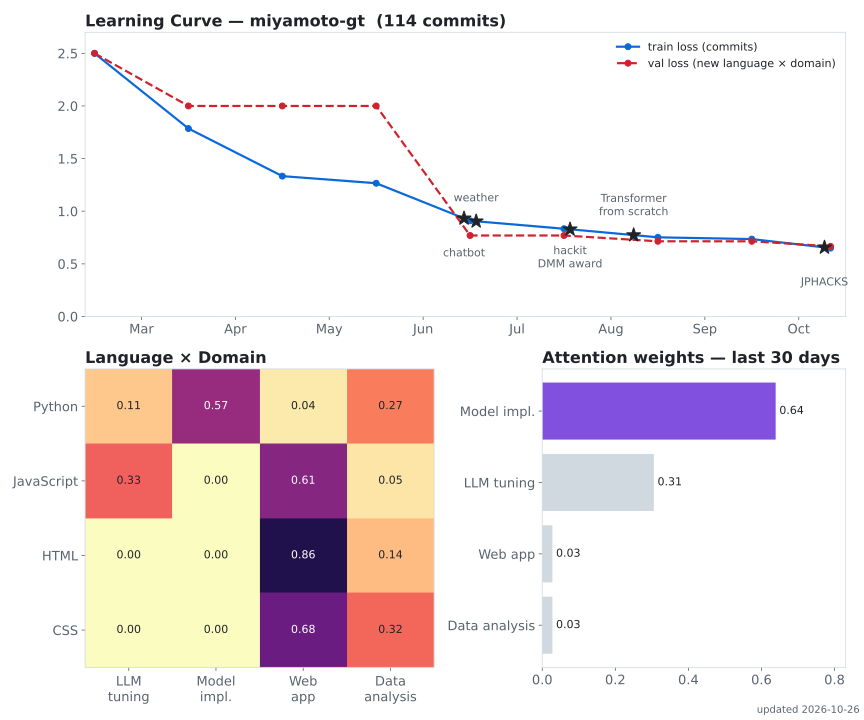

## 👋 Hi, I'm Miya

小型LLMを「自分のデータで、自分の用途に合わせて」育てることに取り組んでいる学生です。
モデルの中身を理解すること、そして作ったモデルを実際に動くアプリに組み込むことの両方を大事にしています。

## 🔭 What I'm doing now

- **🧠 Transformerを0から作って、中身を理解する**
  Attentionをnumpyで手書きするところから始めて、PyTorchで小さなTransformerを自作しています。壊して挙動を観察しながら、AIの内部で何が起きているかを追っています。
- **🔧 小型LLMを追加学習して、アプリ専用のモデルにする**
  大きなモデルの出力を教師データとして集め、LFM2.5などの小型モデルにLoRAで学習させています。データの設計・収集から学習、アプリへの組み込みまでを一通りやっています。
- **📚 RAGで小型モデルの限界を補う**
  3B規模のモデル単体で何ができて何ができないかを測り、足りない部分を検索で補う設計を試しています。
- **🌱 LLM-jp に参加中**

## 🎯 Goal

卒業までに、自分で学習したモデルを1つ公開し、他の人が使える状態にすること。

## 📊 Model Card

<picture>
  <source media="(prefers-color-scheme: dark)" srcset="assets/profile-charts-dark.svg" />
  
</picture>

## 🚀 Projects

| Project | 何をしたか | 技術 |
| --- | --- | --- |
| [あいづち \| AIZUCHI](https://github.com/Hackit-2026/Team18) | 一人配信にAIが視聴者コメントを返すアプリ。基盤サイトを実装し、コメント生成用の小型モデルを自作データで学習中(hackit 2026 DMM賞) | Node.js / OpenAI API / LFM2.5 / Unsloth |
| [kz_2607](https://github.com/jphacks/kz_2607) | (ここに一言説明)。性格の軸ごとのLoRAによる生成と、自作Transformerによる判定モデルを担当(JPHACKS 2026) | PyTorch / LoRA |
| [Transformer0-1](https://github.com/miyamoto-gt/Transformer0-1) | AttentionのスクラッチからTransformerの自作まで | NumPy / PyTorch |
| [weather_model](https://github.com/miyamoto-gt/weather_model) + [weather_predict_site](https://github.com/miyamoto-gt/weather_predict_site) | 気象庁データで翌日の天気を予測するモデルを作り、API化してWebアプリに(個人開発) | pandas / statsmodels / FastAPI |
| [chatbot](https://github.com/miyamoto-gt/chatbot) | 機械学習の学習支援チャットボット。質問履歴から「学んだこと・復習すべきこと」を要約(個人開発) | Gemini API / Express |

## 🌱 Skills

<!-- TODAY:START -->
### 🔢 今日の数 (2026-10-27)

- 今日は元日から **300日目**。**300** は素数ではありません(300 = 22 × 3 × 52)
- 約数の和で分類すると **過剰数**
- π: 今日の日付 **1027** は、円周率の小数点以下 **163桁目** から現れます
<!-- TODAY:END -->
